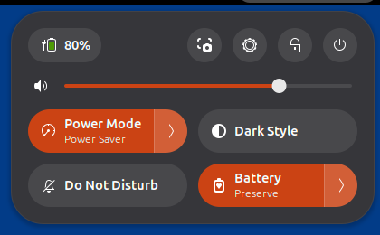
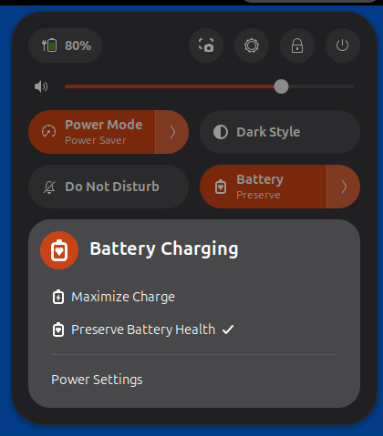

# Battery Charging

A GNOME Shell extension that switches **Battery Charging** between **Maximize Charge** and **Preserve Battery Health** from Quick Settings, next to Power Mode.

<p>
  
  
</p>

- **The toggle** is lit while Preserve Battery Health is on. Click it to switch modes, or open its menu to pick one.
- **The setting** is UPower's, the same one GNOME Settings' Power page shows, so the two always agree. The extension stores nothing of its own and has no preferences.
- **Every supporting battery** (a laptop battery whose firmware lets UPower limit its charge) is switched together. The toggle is hidden on machines without one.
- **A refused switch** (for example from a remote or inactive session) snaps the toggle back and posts a notification.
- **On GNOME 50**, a battery icon with a heart shows in the top bar while Preserve Battery Health is on.

  

It needs UPower 1.90.6 or later and a supporting battery. `src/metadata.json` lists the GNOME Shell versions it has been checked on.

## Installing

From a checkout:

```sh
make install
```

Then log out and back in (on Wayland the shell can't reload extensions), and enable it:

```sh
gnome-extensions enable battery-charging@stanleygoldman.github.io
```

## Make targets

| Target | What it does |
|---|---|
| `make test` | Runs the unit tests under `gjs`. Fast. |
| `make coverage` | Runs the unit tests with coverage of `src/`. Writes `dist/coverage/coverage.lcov`, an HTML report in `dist/coverage/html/` and a Markdown table of line coverage per file in `dist/coverage/summary.md`. `BASE=<commit>` adds the share of the lines changed since that commit that the tests ran. A low figure never fails it; a failing test does. |
| `make test-integration` | Packs the extension, then runs the headless GNOME Shell tests against a mock UPower. |
| `make screenshots` | Packs the extension, then retakes the README screenshots in `docs/screenshots/` in a headless GNOME Shell against a mock UPower. |
| `make pack` | Builds the installable zip in `dist/`. |
| `make install` | Packs the zip and installs it for the current user. |
| `make uninstall` | Uninstalls it for the current user. |
| `make pot` | Regenerates the translation template, `po/battery-charging@stanleygoldman.github.io.pot`. |
| `make lint` | Runs every check and fails on any finding: ESLint and Prettier on the JavaScript, shellcheck and shfmt on the shell scripts, ruff on the Python, actionlint on the GitHub Actions workflows, and `typos`. `make -k lint` reports every failing group. |
| `make format` | Rewrites the JavaScript, shell and Python files in place with Prettier, shfmt and ruff. |
| `make typos` | Spell-checks the repo. Project words and false positives go in `_typos.toml`. |
| `make check-deps` | Lists missing tools and the commands that install them: an `apt` line, plus `uv tool install ruff`, `cargo install typos-cli`, `go install` for actionlint and `sudo locale-gen en_US.UTF-8` for the integration tests' locale. It never runs `sudo` itself. |
| `make ci` | Runs every check CI runs, in order: the linters, `typos`, the unit tests (through `make coverage`), `pack` and the integration tests. |
| `make ci-image` | Builds the CI image, `battery-charging-ci:latest`, from `.github/Dockerfile`: Ubuntu 26.04 (GNOME Shell 50) with every tool the checks need, at pinned versions. Needs Docker. |
| `make ci-docker` | Builds the CI image, then runs `make ci` in it with the checkout mounted, as CI does, so a green run predicts a green CI. |

`make lint` and `make format` install the pinned ESLint and Prettier into `node_modules/` with `npm ci` on first use. Lint rule exceptions are made on the one line, with a comment giving the reason, not repo-wide. To skip the mechanical reformat in `git blame`, run `git config blame.ignoreRevsFile .git-blame-ignore-revs` once.

CI (`.github/workflows/ci.yml`) runs each of `make ci`'s checks as a step of its own in the CI image, on every pull request and push to `main`. A change to Markdown, `docs/` or `.claude/` alone runs only `typos`. `.github/in-image.sh <command>` runs any command in the image the same way.

The `Protect main` ruleset makes every change to `main` go through a pull request, and requires the `ci` check, the workflow's last job, which passes only when every other job passed or was skipped. A pull request doesn't need to be up to date with `main` to merge. Each merge's own run on `main` checks the result.

CI runs the integration tests in a job of their own and uploads each language pass's log, with the mock UPower's logs and a screenshot of each failed test, as the `integration-logs` artifact, pass or fail.

CI puts the coverage summary in the run's job summary and uploads the lcov, HTML report and summary as the `coverage` artifact. On a pull request from this repository it also keeps one coverage comment, replaced on every push, with the share of the pull request's changed lines the tests ran. Coverage counts the unit tests alone: lines only the integration tests reach show as uncovered, and `src/extension.js`, which the unit tests never load, is listed as not loaded, its changed lines counted apart as not measured.

Before a release, work through [`docs/release-checklist.md`](docs/release-checklist.md).

## Translating

1. Copy the template to `po/<lang>.po`, e.g. `po/fr.po`:

   ```sh
   msginit -i po/battery-charging@stanleygoldman.github.io.pot -o po/fr.po -l fr
   ```

2. Translate the strings. The comments above each one say where it appears and how long it may be.
3. Run `make pack`. It compiles every `.po` in `po/` into the zip, with no code change.

The mode names ("Battery Charging", "Maximize Charge", "Preserve Battery Health") and "Power Settings" aren't in the template. They come from GNOME Settings' and GNOME Shell's own translations, so they read the same as in Settings.

## Icon attribution

The two icons in `src/icons/` are derived from the battery outline in Adwaita's `battery-symbolic` icon ([adwaita-icon-theme](https://gitlab.gnome.org/GNOME/adwaita-icon-theme)), licensed under LGPL-3.0 or CC-BY-SA-3.0. They keep that licence.
